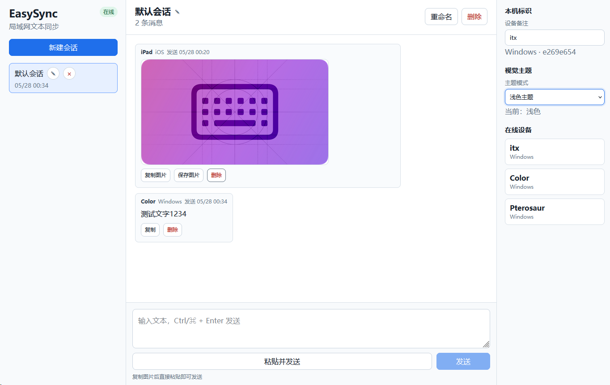

# EasySync

EasySync 是一个局域网文本同步工具。一台 Windows、Linux 或 macOS 设备运行 Go 服务端，其他设备通过浏览器访问同一端口即可发送和查看文本消息。



## Release 下载

如果你只是想直接使用，请到 GitHub Release 下载对应平台的发布包：

[Release链接](https://github.com/Venonary/easysync/releases)

Release 包里已经包含后端可执行文件和嵌入好的前端页面，不需要另外准备 `dist` 目录。

## 当前功能

- 多设备浏览器访问
- WebSocket 实时文本同步
- JSON 文件持久化历史
- 多会话创建、切换、重命名、删除
- 设备备注和在线设备列表
- 粘贴并发送、复制消息
- Go 服务端嵌入并托管 Vue 构建产物
- 支持 Windows / Linux / macOS 多平台发布包
- 支持 HTTP 与 HTTPS 启动
- 支持图片粘贴、图片复制和图片保存

## 开发运行

先安装前端依赖并构建前端：

```powershell
npm.cmd --prefix frontend install
npm.cmd --prefix frontend run build
```

启动服务端：

```powershell
$env:GOCACHE=(Join-Path (Get-Location) '.gocache')

# 默认 HTTP：
go run . -addr :7788

# HTTPS 启动：
go run . -https -addr :7788
```

如果你已经生成了 Release 包，也可以直接运行编译好的二进制：

### Windows

```powershell
.\easysync-windows-amd64.exe -addr :7788
# 或者启用 HTTPS：
.\easysync-windows-amd64.exe -https -addr :7788
```

### Linux

```bash
chmod +x easysync-linux-amd64
./easysync-linux-amd64 -addr :7788
# 或者启用 HTTPS：
./easysync-linux-amd64 -https -addr :7788
```

### macOS

```bash
chmod +x easysync-darwin-amd64
./easysync-darwin-amd64 -addr :7788
# 或者启用 HTTPS：
./easysync-darwin-amd64 -https -addr :7788
```

后端构建打包：

```
go build -o easysync.exe .
```

## HTTPS 注意事项

默认情况下，`-https` 会使用程序自动生成的自签名证书。这个证书适合局域网测试，但浏览器通常会显示“你的连接不是专用连接”或“不受信任”的提示。

这是正常现象，不是程序故障。你可以这样处理：

- 本机/局域网测试：直接忽略警告继续访问，或者把生成的证书导入到受信任根证书中。
- 长期对外使用：使用正式域名和受信任证书，例如 Let’s Encrypt。
- 开发环境：可以使用 `mkcert` 生成受信任的本地证书，然后通过 `-tls-cert` 和 `-tls-key` 指定。

示例：

```powershell
go run . -https -addr :7788
```

服务启动后会打印本机和局域网访问地址，例如：

```text
http://127.0.0.1:7788
http://192.168.1.23:7788
```

如果启用了 HTTPS，则地址会变为 `https://...`。

## 数据目录

默认数据写入 `data/store.json`。可以通过 `-data` 指定其他目录：

```powershell
go run . -data D:\easysync-data
```

## 目前已完成的代码改动

- 前端主题支持：浅色、深色、跟随系统
- 图片粘贴发送、图片复制和图片保存
- 会话标题点击直接重命名
- 新建会话名称自动去重
- 左侧会话列表增加删除按钮和确认提示
- 后端支持 HTTPS 启动和自签名证书生成
- 前端构建产物已通过 `go:embed` 嵌入 Go 二进制
- GitHub Release workflow 已更新为现代的 `softprops/action-gh-release@v2`

## 注意事项

- Windows 版 Release 文件通常带 `.exe`，Linux 和 macOS 版二进制通常没有后缀，这是正常的。
- 如果你第一次访问 HTTPS 页面，浏览器的证书警告是预期行为。
- 如果 Release 包是从 GitHub 下载的，建议优先下载与你系统架构一致的版本，例如 `amd64` 或 `arm64`。
- 如果你是在远程 Linux 机器上运行，可以通过 SSH 隧道从本机浏览器访问。

## 下一步计划

- 增加 PIN 码认证和设备授权
- 增加文件上传和下载
- 进一步优化 Release 包说明和安装体验
